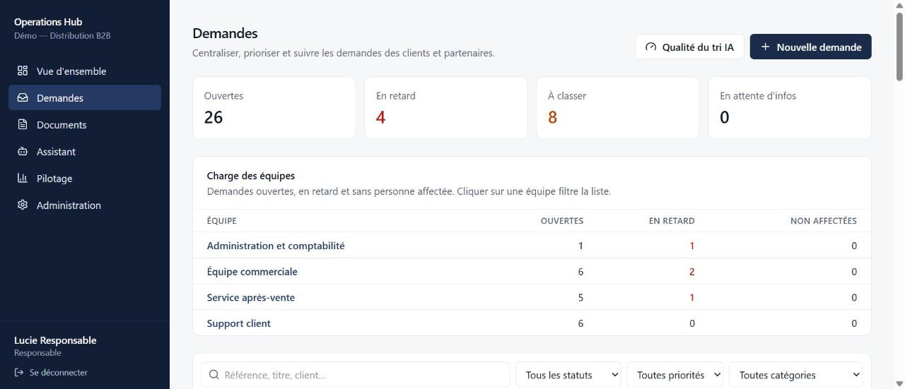
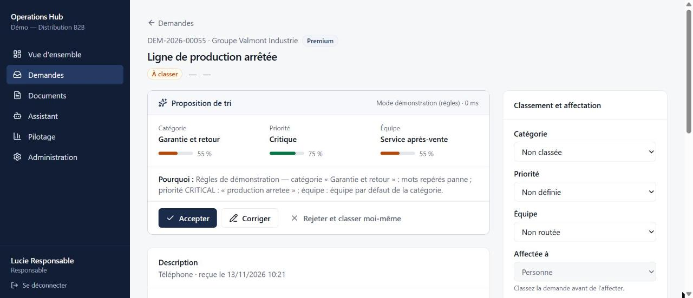
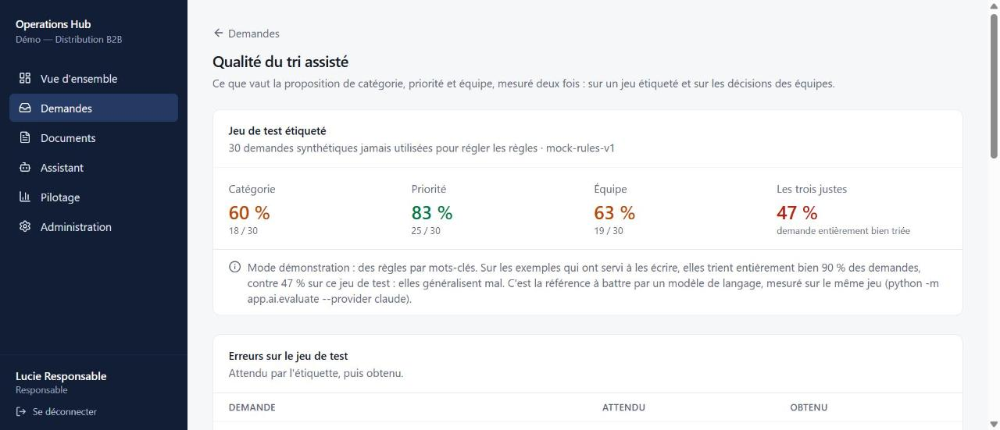
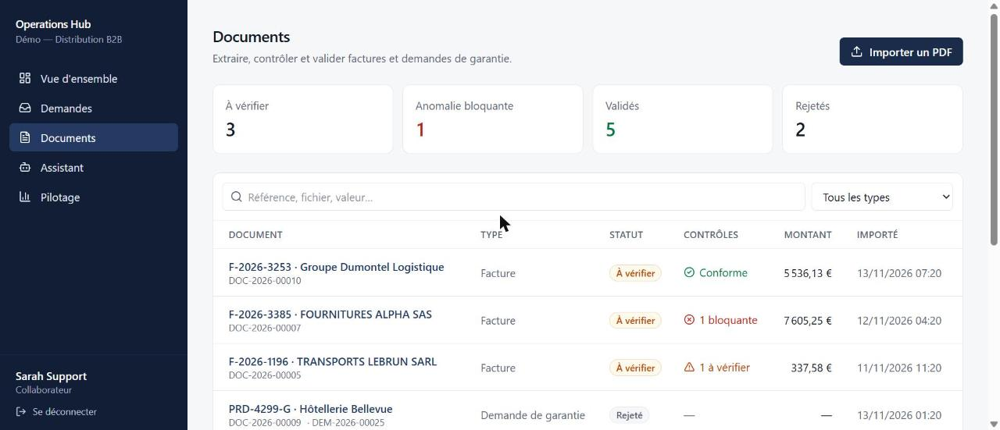
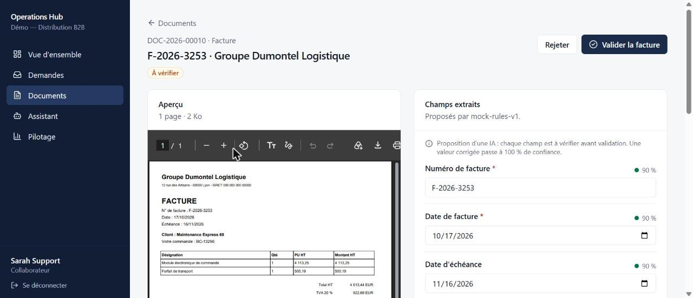
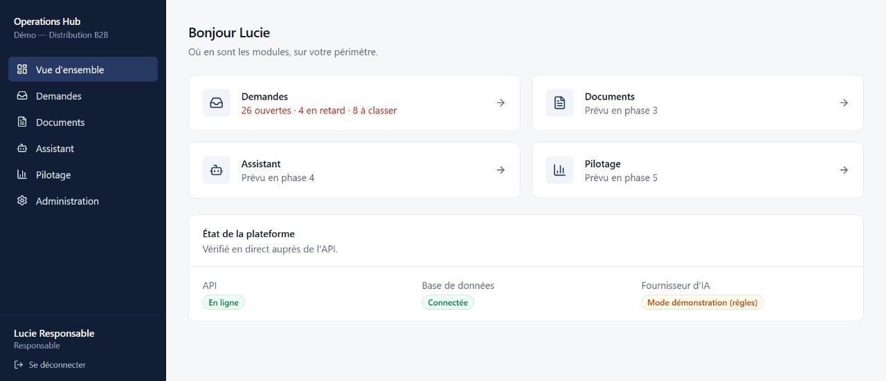

# Business Operations Hub — Intelligent Enterprise Platform

Plateforme web qui structure le travail des équipes support, après-vente, commerciales et administratives d'une entreprise B2B : gestion des demandes, traitement documentaire, assistant de connaissance et cockpit de pilotage, avec une IA qui propose et un humain qui décide.

> Projet personnel de portfolio. Solution générique : le secteur de la démo (automobile, industrie…) se choisit au lancement. Toutes les données sont synthétiques.

## Le problème

Dans beaucoup d'entreprises B2B, les demandes arrivent par mail, téléphone et formulaires et sont triées à la main ; les factures et dossiers de garantie sont lus puis ressaisis ; les procédures sont dispersées ; les délais promis aux clients ne sont pas suivis et les responsables pilotent sans chiffres fiables. Ce problème tient à l'organisation du travail, pas au secteur.

## Origine du projet

J'ai conçu ce cas, puis je l'ai amélioré à partir de mon expérience professionnelle en data et BI dans des entreprises B2B : traitement des demandes, garanties, pilotage de la performance. Les problèmes traités, les règles de gestion et les indicateurs viennent de situations que j'ai rencontrées sur le terrain. Aucune donnée ni aucun élément confidentiel d'un employeur n'est réutilisé.

Je l'ai lancé parce que j'aime ce travail : partir d'un processus qui fait perdre du temps aux équipes, le comprendre, puis construire l'outil qui le simplifie et mesurer s'il tient ses promesses. Ce projet me permet d'aller au bout de cette démarche, du besoin métier jusqu'au code et aux indicateurs.

## Les quatre modules

| Module | Rôle | État |
|---|---|---|
| Socle | Connexion, rôles, équipes, journal d'audit, navigation commune | **Livré (phase 1)** |
| 1. Smart Request Management | Centraliser, prioriser et suivre les demandes ; suggestions IA validées par un humain | **Livré (phase 2)** |
| 2. Intelligent Document Processing | Extraire et contrôler factures et demandes de garantie | **Livré (phase 3)** |
| 3. Enterprise Knowledge Assistant | Répondre depuis la documentation interne, avec sources | Phase 4 |
| 4. Business Intelligence Cockpit | KPI consolidés, dashboard intégré et rapport Power BI | Phase 5 |

## Aperçu

| Demandes : file, indicateurs et charge des équipes | Proposition de tri à valider |
| --- | --- |
|  |  |

| Qualité du tri, mesurée sur un jeu de test | Documents : factures et garanties à contrôler |
| --- | --- |
|  |  |

| Extraction d'une facture, à vérifier champ par champ | Vue d'ensemble |
| --- | --- |
|  |  |

Données de démonstration synthétiques. L'écran d'administration (utilisateurs, rôles, équipes, journal d'audit) est visible dans [`docs/screenshots/administration.png`](docs/screenshots/administration.png).

## Module 1 : gestion des demandes

- **Parcours complet** : saisie, proposition de tri, classement, affectation à un membre de l'équipe, traitement, attente d'informations, résolution, clôture, réouverture. Transitions contrôlées par 12 [règles de gestion](docs/03-processes/request-handling.md) appliquées côté API.
- **Délais (SLA)** : échéances de prise en charge et de résolution calculées selon la priorité, demandes en retard signalées, charge et retards par équipe pour le responsable.
- **Traçabilité** : historique de chaque modification avec auteur, valeur avant et après ; commentaires internes ; pièces jointes PDF vérifiées.
- **IA qui propose, humain qui décide** : catégorie, priorité et équipe proposées avec explication et confiance par champ ; l'agent accepte, corrige ou rejette, et sa décision est tracée. Sans clé API, un mode démonstration à base de règles prend le relais ; il sert aussi de repli si le modèle échoue.
- **Qualité mesurée, pas affirmée** : sur 30 demandes de test jamais utilisées pour régler les règles, le mode démonstration trie entièrement bien **47 %** des demandes, contre 90 % sur les exemples qui ont servi à l'écrire. Le modèle de langage sera mesuré sur le même jeu avant d'annoncer un chiffre. Détails : [évaluation du tri](docs/07-ai-governance/triage-evaluation.md).

## Module 2 : traitement documentaire

- **Import et lecture** : PDF de factures et de demandes de garantie, type et taille vérifiés, texte tiré de la couche PDF ou **lu par OCR** (Tesseract) pour les scans.
- **Extraction structurée** : numéros, dates, montants, émetteur, client, etc., avec un niveau de confiance par champ et une validation de format.
- **Contrôles automatiques** : champs manquants, total incohérent, taux de TVA inhabituel, échéance douteuse, doublon, panne avant achat, hors garantie. Les anomalies bloquantes interdisent la validation tant qu'elles ne sont pas levées.
- **IA qui propose, humain qui décide** : chaque champ est vérifiable ; une correction crée une nouvelle version et passe à 100 % de confiance ; le document est validé, rejeté avec motif, et rattaché à une demande. Tout est tracé.
- **Qualité mesurée** : sur 20 documents de test, le mode démonstration lit entièrement bien **50 %** des documents. Il réussit à 100 % les mises en page qu'il connaît (même scannées) et s'effondre à 22 % sur une mise en page jamais vue — l'écart que le jeu de test est fait pour révéler. Détails : [évaluation de l'extraction](docs/07-ai-governance/document-extraction-evaluation.md).

## Architecture

Monolithe modulaire : une API FastAPI découpée en modules, un frontend Next.js, une base PostgreSQL avec pgvector. Détails et justifications : [architecture cible](docs/04-architecture/target-architecture.md) et [ADR](docs/04-architecture/adr/README.md).

| Couche | Technologies |
|---|---|
| Frontend | Next.js 15, React 19, TypeScript, Tailwind CSS 4, Lucide |
| Backend | Python, FastAPI, Pydantic, SQLAlchemy 2, Alembic |
| Données | PostgreSQL 16, pgvector |
| Qualité | Pytest, Ruff, mypy (strict), ESLint, GitHub Actions |
| Infra | Docker Compose |

## Lancer le projet

Prérequis : Docker Desktop.

```sh
cp .env.example .env          # puis adapter si besoin
docker compose up --build
```

- Application : http://localhost:3000
- Documentation de l'API : http://localhost:8000/api/docs

Au premier démarrage, l'API applique les migrations et crée l'organisation de démonstration du profil `DEMO_PROFILE` (7 utilisateurs fictifs, 4 équipes, 10 clients et partenaires, 60 demandes et 10 documents à différents stades). Les comptes sont listés dans [`backend/app/demo_profiles.py`](backend/app/demo_profiles.py) ; leur mot de passe est la valeur `DEMO_PASSWORD` du fichier `.env`.

### Développement sans conteneur pour l'API et le frontend

```sh
docker compose up -d db
cd backend && pip install -e ".[dev]" && alembic upgrade head && python -m app.seed
uvicorn app.main:app --reload            # http://localhost:8000
cd ../frontend && npm install && npm run dev   # http://localhost:3000
```

### Tests et qualité

```sh
cd backend && ruff check . && mypy app && pytest     # base de test boh_test, migrée à chaque run
cd frontend && npm run lint && npx tsc --noEmit
```

## Documentation

| Document | Contenu |
|---|---|
| [Diagnostic](docs/08-project-management/phase-0-diagnostic.md) | Existant, points de vigilance |
| [Scénario de démonstration](docs/01-business-context/demo-scenario.md) | Profils sectoriels, flux traités, situation de départ |
| [Vision produit](docs/01-business-context/product-vision.md) | Contexte, problématique, objectifs, indicateurs |
| [Project Charter](docs/01-business-context/project-charter.md) | Périmètre MVP, hors périmètre, hypothèses, contraintes, risques |
| [Parties prenantes](docs/01-business-context/stakeholders.md) | Cartographie, rôles, personas |
| [Exigences](docs/02-requirements/business-requirements.md) | Exigences métier et non fonctionnelles |
| [Rôles et permissions](docs/02-requirements/roles-permissions.md) | Matrice des droits, reliée aux tests |
| [Architecture cible](docs/04-architecture/target-architecture.md) | Monolithe modulaire, stack, interactions entre modules |
| [ADR](docs/04-architecture/adr/README.md) | Décisions d'architecture |
| [Modèle de données v0](docs/05-data-model/data-model-v0.md) | Entités et schéma analytique |
| [Backlog](docs/08-project-management/backlog.md) | Épics et user stories priorisées |
| [Roadmap](docs/08-project-management/roadmap.md) | Phases, durées, ordre de réalisation |
| [Definition of Done](docs/08-project-management/definition-of-done.md) | Critères de fin d'une story |
| [Traitement des demandes](docs/03-processes/request-handling.md) | Processus AS-IS / TO-BE, cycle de vie, règles de gestion, SLA |
| [Évaluation du tri assisté](docs/07-ai-governance/triage-evaluation.md) | Jeu de test, résultats, garde-fous, limites |
| [Traitement documentaire](docs/03-processes/document-processing.md) | Processus, cycle de vie, règles de traitement et contrôles |
| [Évaluation de l'extraction](docs/07-ai-governance/document-extraction-evaluation.md) | Jeu de documents, résultats par champ et mise en page, garde-fous |
| [Bilan phase 1](docs/08-project-management/phase-1-report.md) | Réalisé, tests, décisions, suite |
| [Bilan phase 2](docs/08-project-management/phase-2-report.md) | Module Demandes : réalisé, tests, décisions, suite |
| [Bilan phase 3](docs/08-project-management/phase-3-report.md) | Module Documents : réalisé, tests, décisions, suite |

## Limites connues

- Pas encore de limitation des tentatives de connexion.
- L'IA par modèle de langage (`AI_PROVIDER=claude`), pour le tri comme pour l'extraction, est branchée mais pas encore évaluée : seul le mode démonstration a des résultats mesurés.
- Délais SLA en temps calendaire, sans calendrier ouvré ; période de garantie fixée à 24 mois.
- Deux types de documents au MVP (facture, garantie). Au premier démarrage, la page « Qualité de l'extraction » n'est prête qu'après le pré-calcul OCR (~1 min) ; un rafraîchissement suffit.
- Les demandes sont saisies par un collaborateur : pas encore de réception automatique des e-mails.
- Types TypeScript de l'API écrits à la main et pas encore de tests end-to-end (Playwright) : le parcours a été vérifié manuellement dans le navigateur. Voir le [bilan de phase 2](docs/08-project-management/phase-2-report.md).
