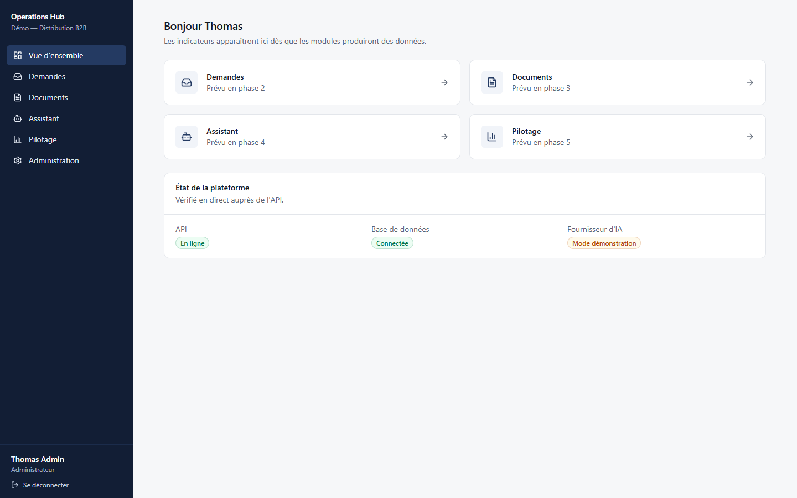
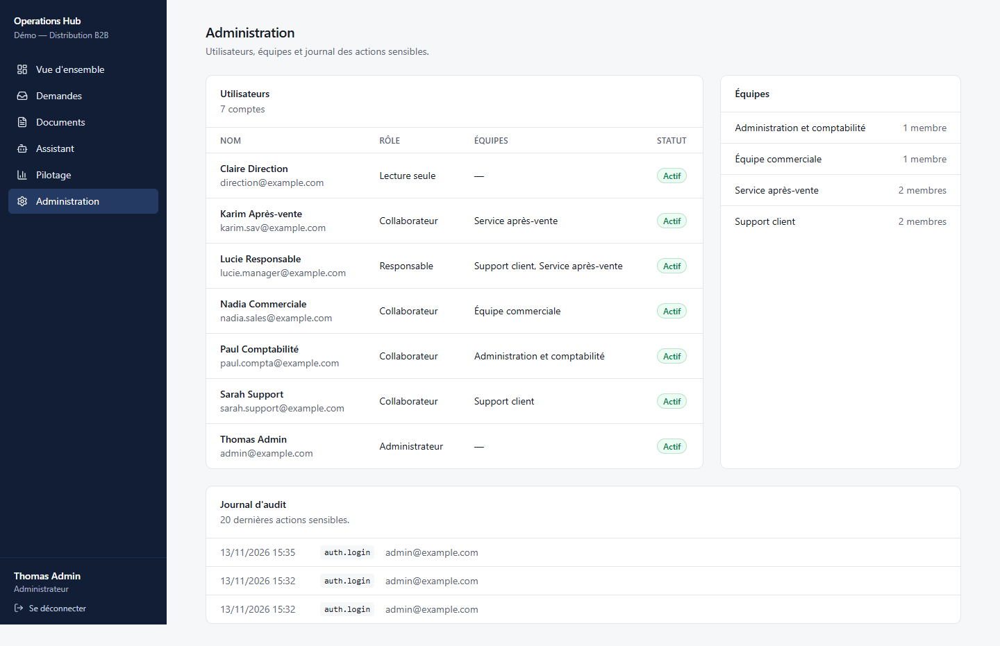

# Business Operations Hub — Intelligent Enterprise Platform

Plateforme web qui structure le travail des équipes support, après-vente, commerciales et administratives d'une entreprise B2B : gestion des demandes, traitement documentaire, assistant de connaissance et cockpit de pilotage, avec une IA qui propose et un humain qui décide.

> Projet personnel de portfolio. Solution générique : le secteur de la démo (automobile, industrie…) se choisit au lancement. Toutes les données sont synthétiques.

## Le problème

Dans beaucoup d'entreprises B2B, les demandes arrivent par mail, téléphone et formulaires et sont triées à la main ; les factures et dossiers de garantie sont lus puis ressaisis ; les procédures sont dispersées ; les délais promis aux clients ne sont pas suivis et les responsables pilotent sans chiffres fiables. Ce problème tient à l'organisation du travail, pas au secteur.

## Origine du projet

J'ai conçu ce cas, puis je l'ai amélioré à partir de mon expérience professionnelle en data et BI dans des entreprises B2B : traitement des demandes, garanties, pilotage de la performance. Les problèmes traités, les règles de gestion et les indicateurs viennent de situations que j'ai rencontrées sur le terrain. Aucune donnée ni aucun élément confidentiel d'un employeur n'est réutilisé.

Je l'ai lancé parce que j'aime ce travail : partir d'un processus qui fait perdre du temps aux équipes, le comprendre, puis construire l'outil qui le simplifie et mesurer s'il tient ses promesses. Ce projet me permet d'aller au bout de cette démarche, du besoin métier jusqu'au code et aux indicateurs.

## Les quatre modules

| Module | Rôle | État |
|---|---|---|
| Socle | Connexion, rôles, équipes, journal d'audit, navigation commune | **Livré (phase 1)** |
| 1. Smart Request Management | Centraliser, prioriser et suivre les demandes ; suggestions IA validées par un humain | Phase 2 |
| 2. Intelligent Document Processing | Extraire et contrôler factures et demandes de garantie | Phase 3 |
| 3. Enterprise Knowledge Assistant | Répondre depuis la documentation interne, avec sources | Phase 4 |
| 4. Business Intelligence Cockpit | KPI consolidés, dashboard intégré et rapport Power BI | Phase 5 |

## Aperçu (phase 1)

| Vue d'ensemble | Administration |
| --- | --- |
|  |  |

Données de démonstration synthétiques. Les modules métier arrivent à partir de la phase 2.

## Architecture

Monolithe modulaire : une API FastAPI découpée en modules, un frontend Next.js, une base PostgreSQL avec pgvector. Détails et justifications : [architecture cible](docs/04-architecture/target-architecture.md) et [ADR](docs/04-architecture/adr/README.md).

| Couche | Technologies |
|---|---|
| Frontend | Next.js 15, React 19, TypeScript, Tailwind CSS 4, Lucide |
| Backend | Python, FastAPI, Pydantic, SQLAlchemy 2, Alembic |
| Données | PostgreSQL 16, pgvector |
| Qualité | Pytest, Ruff, mypy (strict), ESLint, GitHub Actions |
| Infra | Docker Compose |

## Lancer le projet

Prérequis : Docker Desktop.

```sh
cp .env.example .env          # puis adapter si besoin
docker compose up --build
```

- Application : http://localhost:3000
- Documentation de l'API : http://localhost:8000/api/docs

Au premier démarrage, l'API applique les migrations et crée l'organisation de démonstration du profil `DEMO_PROFILE` (7 utilisateurs fictifs, 4 équipes). Les comptes sont listés dans [`backend/app/seed.py`](backend/app/seed.py) ; leur mot de passe est la valeur `DEMO_PASSWORD` du fichier `.env`.

### Développement sans conteneur pour l'API et le frontend

```sh
docker compose up -d db
cd backend && pip install -e ".[dev]" && alembic upgrade head && python -m app.seed
uvicorn app.main:app --reload            # http://localhost:8000
cd ../frontend && npm install && npm run dev   # http://localhost:3000
```

### Tests et qualité

```sh
cd backend && ruff check . && mypy app && pytest     # base de test boh_test, migrée à chaque run
cd frontend && npm run lint && npx tsc --noEmit
```

## Documentation

| Document | Contenu |
|---|---|
| [Diagnostic](docs/08-project-management/phase-0-diagnostic.md) | Existant, points de vigilance |
| [Scénario de démonstration](docs/01-business-context/demo-scenario.md) | Profils sectoriels, flux traités, situation de départ |
| [Vision produit](docs/01-business-context/product-vision.md) | Contexte, problématique, objectifs, indicateurs |
| [Project Charter](docs/01-business-context/project-charter.md) | Périmètre MVP, hors périmètre, hypothèses, contraintes, risques |
| [Parties prenantes](docs/01-business-context/stakeholders.md) | Cartographie, rôles, personas |
| [Exigences](docs/02-requirements/business-requirements.md) | Exigences métier et non fonctionnelles |
| [Rôles et permissions](docs/02-requirements/roles-permissions.md) | Matrice des droits, reliée aux tests |
| [Architecture cible](docs/04-architecture/target-architecture.md) | Monolithe modulaire, stack, interactions entre modules |
| [ADR](docs/04-architecture/adr/README.md) | Décisions d'architecture |
| [Modèle de données v0](docs/05-data-model/data-model-v0.md) | Entités et schéma analytique |
| [Backlog](docs/08-project-management/backlog.md) | Épics et user stories priorisées |
| [Roadmap](docs/08-project-management/roadmap.md) | Phases, durées, ordre de réalisation |
| [Definition of Done](docs/08-project-management/definition-of-done.md) | Critères de fin d'une story |
| [Bilan phase 1](docs/08-project-management/phase-1-report.md) | Réalisé, tests, décisions, suite |

## Limites connues (phase 1)

- Pas encore de limitation des tentatives de connexion.
- Les types TypeScript de l'API sont écrits à la main ; ils seront générés depuis l'OpenAPI en phase 2.
- Pas encore de tests end-to-end (Playwright) : ils arrivent avec le premier parcours métier, en phase 2.
