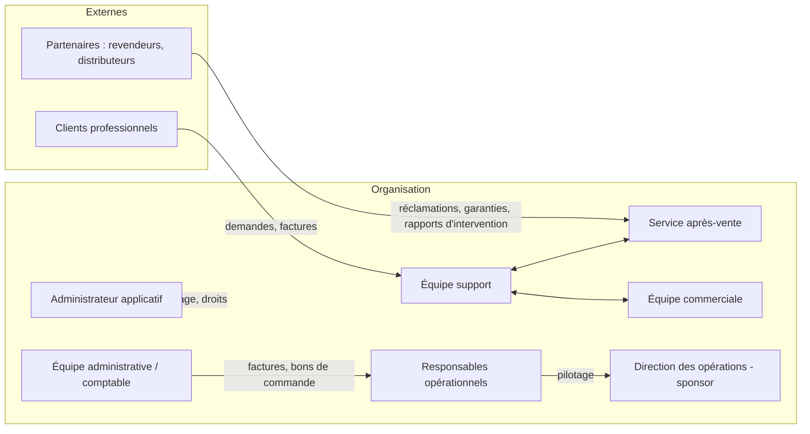

# Utilisateurs et parties prenantes

## Cartographie

## Matrice influence / intérêt

| Partie prenante | Intérêt | Influence | Stratégie |
|---|---|---|---|
| Direction des opérations (sponsor) | Élevé | Élevée | Associer aux arbitrages, KPI de pilotage |
| Responsables opérationnels | Élevé | Élevée | Co-construire SLA, règles de priorité, dashboards |
| Support, SAV, commercial, administratif | Élevé | Moyenne | Ateliers d'usage, recette (UAT) |
| Administrateur applicatif | Moyen | Moyenne | Paramétrage, rôles, journal d'audit |
| Clients et partenaires | Moyen | Faible (indirecte) | Bénéficiaires : délais et qualité de réponse |
| Délégué à la protection des données | Moyen | Élevée sur le sujet | Minimisation des données, durée de conservation |

## Rôles applicatifs (MVP)

| Rôle | Utilisateur type | Droits principaux |
|---|---|---|
| `ADMIN` | Administrateur applicatif | Utilisateurs, équipes, SLA, catégories, journal d'audit |
| `MANAGER` | Responsable opérationnel | Tout le périmètre de ses équipes, réaffectation, dashboards complets, documents de connaissance « responsables » |
| `AGENT` | Collaborateur support / SAV / commercial / administratif | Demandes et documents de ses équipes, validation des suggestions IA, assistant |
| `VIEWER` | Contrôle de gestion, direction | Lecture des dashboards et des demandes, pas de modification |

## Personas

- **Sarah, agent support.** Traite 40 demandes par jour. Attend : une file triée par priorité et SLA, une suggestion de catégorie qu'elle peut corriger en un clic.
- **Karim, technicien SAV.** Reçoit des demandes de garantie avec des PDF. Attend : les champs pré-remplis et les anomalies signalées, puis le rattachement à la demande.
- **Lucie, responsable opérationnelle.** Attend : la charge par équipe, les SLA en retard et les points de blocage, sans export Excel manuel.
- **Thomas, administrateur.** Attend : gérer les droits, voir qui a validé quoi.

Les personas sont fictifs et servent à écrire les user stories.
