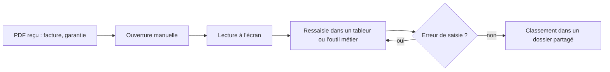
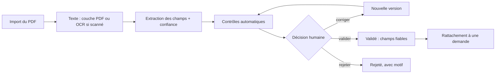

# Traitement documentaire : processus et règles

Module 2 (Intelligent Document Processing). État au 13/11/2026, phase 3. Deux types au MVP :
**factures** et **demandes de garantie**. Les règles RD-01 à RD-08 (traitement) et RC-01 à RC-09
(contrôles) sont appliquées côté API (`backend/app/modules/documents/`) et couvertes par des tests.

## Processus actuel (AS-IS)

Douleurs : ressaisie lente et source d'erreurs ; pas de contrôle systématique (totaux, doublons,
garantie expirée) ; aucune trace de qui a saisi quoi ; documents éparpillés, non reliés aux demandes.

## Processus cible (TO-BE)

L'IA **propose**, l'humain **décide** : aucune extraction n'est enregistrée comme vérité sans
validation. Les champs à faible confiance et les anomalies dirigent l'attention là où elle est utile.

## Cycle de vie d'un document

| Statut | Signification |
|---|---|
| `TO_REVIEW` (À vérifier) | Importé, extraction proposée (ou texte illisible à saisir à la main) |
| `VALIDATED` (Validé) | Champs confirmés par un collaborateur ; lecture seule |
| `REJECTED` (Rejeté) | Écarté avec un motif ; lecture seule |

## Règles de traitement

| ID | Règle | Test |
|---|---|---|
| RD-01 | Chaque document reçoit une référence `DOC-AAAA-NNNNN`, séquentielle par organisation et par année. | `test_upload_extracts_invoice_fields` |
| RD-02 | PDF uniquement, vérifié sur le contenu (signature `%PDF-`), taille plafonnée (`MAX_UPLOAD_MB`, 10 Mo). | `test_upload_rejects_non_pdf_and_large_files` |
| RD-03 | Le texte est tiré de la couche texte du PDF ; une page sans texte exploitable passe par l'OCR (Tesseract, français). Un document illisible reste importé pour une saisie manuelle. | `test_scanned_document_goes_through_ocr`, `test_corrupted_pdf_is_kept_for_manual_entry` |
| RD-04 | Les champs sont extraits puis validés par schéma (dates ISO, montants à deux décimales). Un champ absent vaut vide. | `test_upload_extracts_invoice_fields` |
| RD-05 | Les contrôles sont recalculés à chaque version (proposition et corrections). | `test_blocking_anomaly_prevents_validation_until_corrected` |
| RD-06 | Une correction crée une nouvelle version ; les versions précédentes restent consultables. Un champ corrigé passe à 100 % de confiance. | `test_blocking_anomaly_prevents_validation_until_corrected` |
| RD-07 | La validation est impossible tant qu'une anomalie **bloquante** subsiste. La décision (accepté / corrigé / rejeté) est tracée dans le journal d'audit. | `test_blocking_anomaly_prevents_validation_until_corrected`, `test_reject_needs_a_reason_and_is_final` |
| RD-08 | Un document non rejeté peut être rattaché (ou détaché) d'une demande visible ; l'opération est tracée dans l'historique de la demande (US-306). | `test_link_to_request_is_traced_on_both_sides`, `test_cannot_link_to_an_invisible_request` |

## Champs extraits

| Facture | Demande de garantie |
|---|---|
| Numéro, date, échéance | Client |
| Émetteur, client facturé | Référence produit, numéro de série |
| Référence de commande | Date d'achat, date de la panne |
| Total HT, TVA, total TTC | Facture d'achat |
| | Description de la panne |

## Contrôles

| ID | Code | Gravité | Règle | Test |
|---|---|---|---|---|
| RC-01 | `MISSING_FIELD` | Bloquant | Un champ obligatoire est vide. | `test_controls_rules` |
| RC-02 | `INCONSISTENT_TOTAL` | Bloquant | Total HT + TVA ≠ total TTC (au-delà de l'arrondi). | `test_controls_rules` |
| RC-03 | `DUE_BEFORE_INVOICE` | Avertissement | Échéance antérieure à la date de facture. | `test_controls_rules` |
| RC-04 | `UNUSUAL_VAT_RATE` | Avertissement | Taux de TVA hors des taux français usuels. | `test_controls_rules` |
| RC-05 | `DUPLICATE` | Bloquant | Même fichier, ou même clé métier (émetteur + numéro de facture ; numéro de série + date de panne) qu'un document non rejeté. | `test_duplicates_are_blocking` |
| RC-06 | `FAILURE_BEFORE_PURCHASE` | Bloquant | Panne datée avant l'achat. | `test_controls_rules` |
| RC-07 | `OUT_OF_WARRANTY` | Avertissement | Panne plus de 24 mois après l'achat. | `test_controls_rules` |
| RC-09 | `DATE_IN_FUTURE` | Avertissement | Une date (hors échéance) est postérieure à aujourd'hui. | `test_controls_rules` |

Un **avertissement** n'empêche pas la validation : il attire l'œil sans bloquer. Seules les anomalies
**bloquantes** interdisent de valider tant qu'elles ne sont pas levées.

## Limites assumées

- Deux types seulement (facture, garantie). Les autres (justificatifs, rapports, bons de commande) sont prévus en évolution.
- Période de garantie fixée à 24 mois pour la démonstration, sans distinction de produit ni de condition contractuelle.
- Un document par PDF ; pas de découpage d'un PDF multi-documents.
