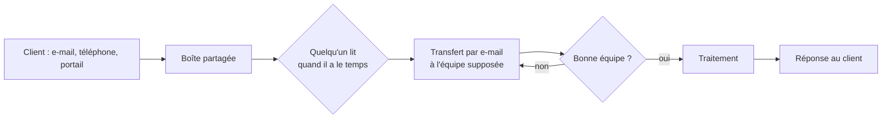
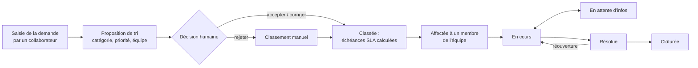

# Traitement des demandes : processus et règles de gestion

Module 1 (Smart Request Management). État au 13/11/2026, phase 2. Les règles RG-01 à RG-12 sont appliquées côté API (`backend/app/modules/requests/`) et chacune est vérifiée par au moins un test.

## Processus actuel (AS-IS)

Situation type d'une entreprise B2B sans outil dédié :

Douleurs observées :
- le tri dépend de la personne qui lit la boîte ; une demande mal routée rebondit d'équipe en équipe ;
- aucune priorité commune : « urgent » veut dire autre chose pour chacun ;
- aucun délai suivi : on découvre le retard quand le client relance ;
- pas d'historique : impossible de savoir qui a fait quoi, ni pourquoi une demande a été reclassée ;
- pas de chiffres pour le responsable : charge des équipes et retards restent invisibles.

## Processus cible (TO-BE)

Ce qui change : la proposition de tri est immédiate et expliquée, mais **rien n'est appliqué sans décision humaine** ; les échéances sont calculées dès le classement ; chaque modification est historisée ; le responsable voit la charge et les retards de ses équipes.

## Cycle de vie

| Statut | Signification | Entrée |
|---|---|---|
| `NEW` (À classer) | Demande saisie, pas encore classée | Création |
| `CLASSIFIED` (Classée) | Catégorie, priorité et équipe connues | Automatique (RG-03) |
| `ASSIGNED` (Affectée) | Une personne de l'équipe en est responsable | Automatique (RG-04) |
| `IN_PROGRESS` (En cours) | Traitement commencé | Manuelle |
| `WAITING_INFO` (En attente d'infos) | Bloquée par une information du client | Manuelle, avec commentaire |
| `RESOLVED` (Résolue) | Réponse apportée | Manuelle, avec commentaire |
| `CLOSED` (Clôturée) | Dossier fermé, lecture seule | Manuelle |

## Règles de gestion

| ID | Règle | Test |
|---|---|---|
| RG-01 | Chaque demande reçoit une référence `DEM-AAAA-NNNNN`, séquentielle par organisation et par année. | `test_create_assigns_sequential_reference_and_pending_suggestion` |
| RG-02 | Transitions manuelles autorisées : Affectée → En cours ; En cours → En attente d'infos ou Résolue ; En attente d'infos → En cours ; Résolue → Clôturée ou En cours. Toute autre transition est refusée (409). | `test_full_lifecycle_with_controlled_transitions` |
| RG-03 | Une demande passe automatiquement de « À classer » à « Classée » dès que catégorie, priorité et équipe sont renseignées. Une demande classée ne peut plus perdre l'une des trois. | `test_accept_classifies_and_sets_sla_due_dates` |
| RG-04 | Seul un membre actif de l'équipe de la demande peut être affecté. Affecter fait passer à « Affectée », désaffecter revient à « Classée ». Changer d'équipe retire l'affecté s'il n'en est pas membre. Une demande en cours, en attente ou résolue doit rester affectée. | `test_assignment_requires_team_member_and_drives_status`, `test_in_progress_request_must_stay_assigned` |
| RG-05 | Échéances de prise en charge et de résolution = date de création + délais de la politique SLA de la priorité, en minutes calendaires. Elles sont recalculées si la priorité change. | `test_accept_classifies_and_sets_sla_due_dates`, `test_sla_state_rules` |
| RG-06 | La prise en charge est datée au premier passage « En cours ». | `test_full_lifecycle_with_controlled_transitions` |
| RG-07 | Rouvrir une demande résolue efface sa date de résolution ; le SLA de résolution court à nouveau. | `test_full_lifecycle_with_controlled_transitions` |
| RG-08 | Passer « En attente d'infos » ou « Résolue » exige un commentaire (ce qui manque, ce qui a été fait). | `test_full_lifecycle_with_controlled_transitions` |
| RG-09 | Chaque modification est historisée avec son auteur, la date, la valeur avant et la valeur après. | `test_history_keeps_before_and_after`, `test_modify_records_final_values` |
| RG-10 | Une proposition de tri est acceptée, corrigée ou rejetée une seule fois. Accepter ou corriger applique le classement ; rejeter ne modifie pas la demande. La décision est tracée dans l'historique et le journal d'audit. | `test_reject_changes_nothing_and_decision_is_final`, `test_modify_records_final_values` |
| RG-11 | Un collaborateur (AGENT) voit les demandes de ses équipes, les demandes non routées et celles qu'il a créées ou qui lui sont affectées. Responsables, administrateurs et direction voient toute l'organisation. | `test_agent_sees_own_teams_and_unrouted_only`, `test_organizations_are_isolated` |
| RG-12 | Priorité : Critique si l'activité du client est à l'arrêt ou en cas de sécurité ; Haute si urgence explicite, relance ou fort impact ; Basse pour une simple information ; Normale sinon. Un client Premium relève d'un cran une priorité Basse ou Normale. | `test_priority_rules`, `test_premium_account_raises_priority` |

### États SLA affichés

| État | Condition |
|---|---|
| Dans les délais | Échéance suivante à plus d'un quart du délai total |
| Échéance proche | Moins d'un quart du délai restant, ou prise en charge faite en retard |
| En retard | Échéance de résolution dépassée, ou prise en charge non faite après son échéance |
| SLA respecté / dépassé | Demande résolue avant / après son échéance de résolution |

### Politiques SLA de la démonstration

| Priorité | Prise en charge | Résolution |
|---|---|---|
| Critique | 1 h | 8 h |
| Haute | 4 h | 24 h |
| Normale | 8 h | 3 jours |
| Basse | 24 h | 5 jours |

Modifiables par un administrateur (`PUT /api/reference/sla/{priority}`, tracé dans le journal d'audit).

### Pièces jointes

PDF uniquement (vérification de la signature du fichier, pas seulement de l'extension), 10 Mo maximum (`MAX_UPLOAD_MB`), empreinte SHA-256 conservée.

## Limites assumées

- Délais en temps calendaire : pas de calendrier ouvré ni de jours fériés.
- Saisie par un collaborateur uniquement : pas encore de réception automatique des e-mails ni de portail client.
