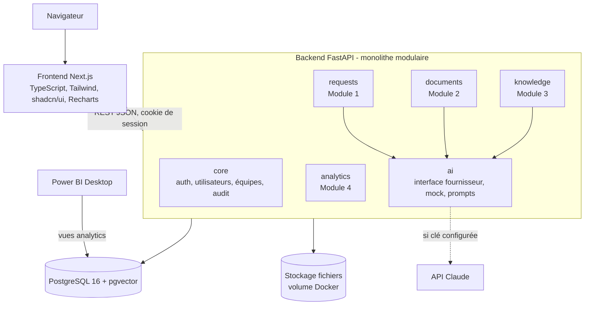
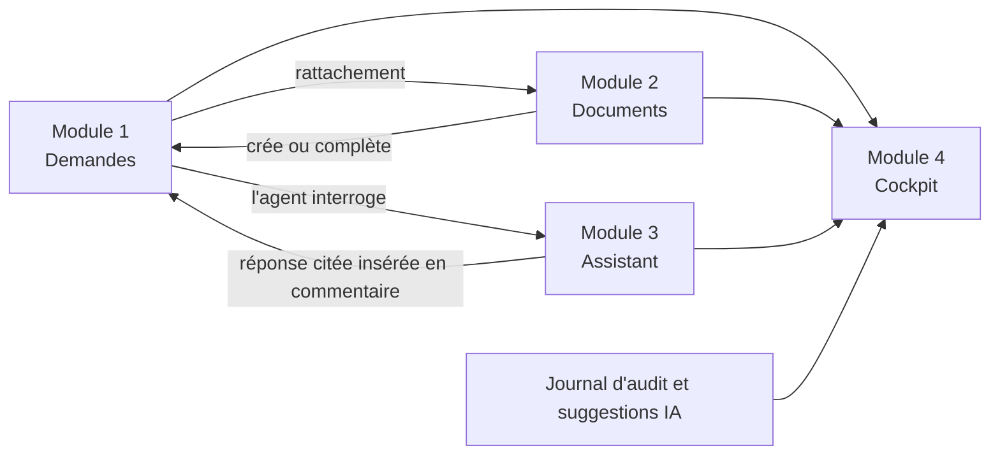

# Architecture cible (proposition v0)

## Choix structurant : monolithe modulaire

Une API FastAPI unique, découpée en modules métier qui partagent la base, l'authentification et l'audit. Un frontend Next.js unique.

**Pourquoi pas des microservices :** une personne, un volume de démonstration modeste et un seul déploiement. Des microservices ajouteraient réseau, déploiements et cohérence distribuée sans bénéfice. Les frontières de modules restent nettes : un module pourrait être extrait plus tard.

## Stack et justification

| Couche | Choix | Raison |
|---|---|---|
| Frontend | Next.js (App Router), React, TypeScript, Tailwind, **shadcn/ui**, Lucide, **Recharts**, TanStack Query | Même socle que le dépôt `port-folio` de Mehdi. shadcn/ui donne des composants sobres et éditables ; Recharts suffit pour des graphiques de pilotage |
| Types partagés | Types TypeScript générés depuis l'OpenAPI de FastAPI | Une seule source de vérité pour les contrats, pas de duplication |
| Backend | Python, FastAPI, Pydantic v2 | Validation et documentation OpenAPI natives ; Python est le langage de l'IA et des données |
| ORM / migrations | SQLAlchemy 2 + Alembic | Standard, typé, migrations versionnées |
| Base | PostgreSQL 16 + pgvector | Une seule base pour le transactionnel, l'analytique (schéma `analytics`) et les vecteurs. Évite une base vectorielle séparée |
| Authentification | Gérée par FastAPI : mot de passe haché (Argon2), JWT en cookie `httpOnly` | Les droits sont contrôlés là où sont les données. Pas de NextAuth à synchroniser |
| IA générative | Interface `LLMProvider` ; implémentations `ClaudeProvider` et `MockProvider` | Indépendance fournisseur, tests sans réseau, démonstration sans clé. Sorties structurées via schémas Pydantic |
| Embeddings | Modèle multilingue local (fastembed / ONNX), à confirmer en phase 4 | Gratuit, hors ligne, données non envoyées à un tiers. Interface `Embedder` remplaçable |
| RAG | Implémentation directe (découpage, recherche pgvector, prompt avec extraits) | ~200 lignes lisibles et explicables en entretien. LangChain / LlamaIndex non justifiés à ce volume |
| PDF / OCR | pypdfium2 (texte et rendu d'images) + Tesseract (`fra`) | Licences permissives ; Tesseract tourne dans l'image Docker |
| Traitements longs | `BackgroundTasks` FastAPI + statut en base | Suffisant au volume prévu. Celery / Redis seulement si un besoin mesuré apparaît |
| Tests | Pytest (unitaires, intégration, API sur base de test), Playwright (parcours essentiels) | Playwright déjà pratiqué (dépôt `PlayWright`) |
| Qualité | Ruff, mypy, ESLint, `tsc` | Lint et typage des deux côtés |
| Infra | Docker Compose (db, api, web), GitHub Actions, `.env.example` | Lancement en une commande ; CI sur chaque push |

## Interactions entre modules

- Un document extrait (facture, garantie) se rattache à une demande existante, ou en crée une.
- Depuis une demande, l'agent interroge l'assistant ; une réponse citée peut être ajoutée en commentaire.
- Toutes les suggestions IA (catégorie, extraction, réponse) passent par une table commune `ai_suggestions` / avis : le cockpit mesure acceptation, modification et rejet de façon homogène.
- Le cockpit lit des **vues SQL** du schéma `analytics`, les mêmes que celles utilisées par Power BI. Un KPI a donc une seule définition.

## Décisions à formaliser en ADR (phase 1)

ADR-001 monolithe modulaire · ADR-002 PostgreSQL + pgvector · ADR-003 authentification côté API · ADR-004 interface fournisseur IA + mode mock · ADR-005 RAG sans framework · ADR-006 embeddings locaux · ADR-007 traitements asynchrones légers · ADR-008 vues analytiques partagées dashboard / Power BI.
