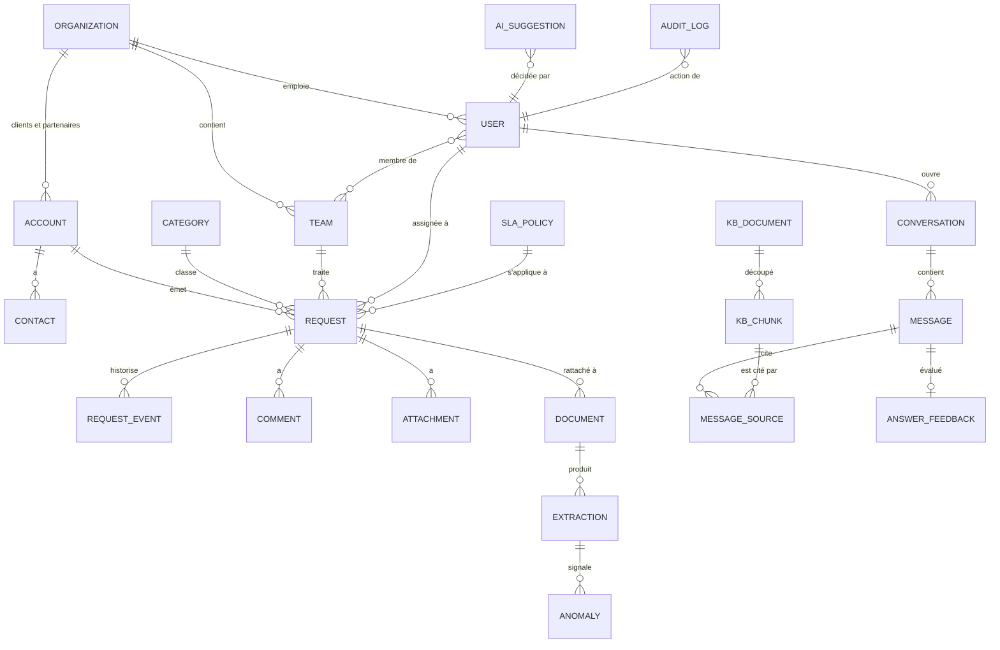

# Modèle de données (proposition v0)

> **État réel au 13/11/2026.** Tables créées : migration `0001` (organisations, équipes, utilisateurs, journal d'audit), migration `0002` (`accounts`, `categories`, `sla_policies`, `requests`, `request_events`, `comments`, `attachments`, `ai_suggestions`) et migration `0003` (`documents`, `extractions`, `anomalies`). Écarts avec la proposition ci-dessous : pas de table `CONTACT` (le client est porté par `accounts`, avec un niveau Standard ou Premium) ; la politique SLA est rattachée à la **priorité** et les échéances sont copiées sur la demande ; `ai_suggestions` est générique (`target_type`, `kind`) et sert aussi au module Documents ; `extractions` est **versionnée** (une ligne par proposition ou correction, jamais modifiée), `anomalies` est recalculée à chaque version, et `documents` porte une `duplicate_key` indexée pour la détection des doublons (RC-05). Les entités des modules 3 et 4 arrivent avec leur module.

Toutes les tables métier portent `organization_id`, `created_at`, `updated_at`. Les données de démonstration portent `is_synthetic = true`.

## Tables principales

| Table | Rôle | Champs clés |
|---|---|---|
| `organizations`, `users`, `teams`, `user_teams` | Socle | `users.role` (`ADMIN`, `MANAGER`, `AGENT`, `VIEWER`), `password_hash` |
| `accounts`, `contacts` | Clients et partenaires (revendeurs, distributeurs) | `accounts.type` (`CUSTOMER`, `PARTNER`), `tier` |
| `categories`, `sla_policies` | Paramétrage | SLA : `priority`, `response_minutes`, `resolution_minutes` |
| `requests` | Demandes | `reference`, `title`, `description`, `channel`, `status`, `priority`, `category_id`, `team_id`, `assignee_id`, `due_response_at`, `due_resolution_at`, `resolved_at`, `closed_at` |
| `request_events` | Historique | `event_type`, `field`, `old_value`, `new_value`, `actor_id` |
| `comments`, `attachments` | Échanges, fichiers | `attachments.storage_key`, `mime_type`, `size_bytes`, `sha256` |
| `documents` | Documents traités | `doc_type` (`INVOICE`, `WARRANTY_CLAIM`, …), `status` (`UPLOADED` → `EXTRACTED` → `VALIDATED` / `REJECTED`), `sha256`, `ocr_used`, `request_id` |
| `extractions` | Résultat d'extraction versionné | `data` (JSONB validé par schéma Pydantic), `field_confidence` (JSONB), `provider`, `validated_by` |
| `anomalies` | Contrôles | `type` (`MISSING_FIELD`, `DUPLICATE`, `INCONSISTENT_AMOUNT`, …), `field`, `message`, `resolved` |
| `kb_documents`, `kb_chunks` | Base de connaissance | `visibility` (`ALL`, `TEAM`, `MANAGERS`), `kb_chunks.embedding vector(N)`, `page`, `position` |
| `conversations`, `messages`, `message_sources`, `answer_feedback` | Assistant | `messages.role`, `latency_ms`, `answer_status` (`ANSWERED`, `INSUFFICIENT_INFO`) ; feedback `rating` ±1 |
| `ai_suggestions` | Toute proposition IA | `target_type`, `target_id`, `kind`, `proposal` (JSONB), `explanation`, `confidence`, `provider`, `decision` (`PENDING`, `ACCEPTED`, `MODIFIED`, `REJECTED`), `final_value` |
| `audit_log` | Actions sensibles | `action`, `entity`, `entity_id`, `actor_id`, `details` |

## Schéma `analytics` (Module 4 et Power BI)

Vues SQL construites sur les tables ci-dessus, sans copie de données :
`analytics.dim_date`, `dim_team`, `dim_category`, `fact_request` (une ligne par demande, durées et respect des SLA), `fact_document`, `fact_question`, `fact_ai_decision`.

Le dictionnaire de données complet (types, contraintes, règles) sera produit en phase 1 à partir des migrations.
